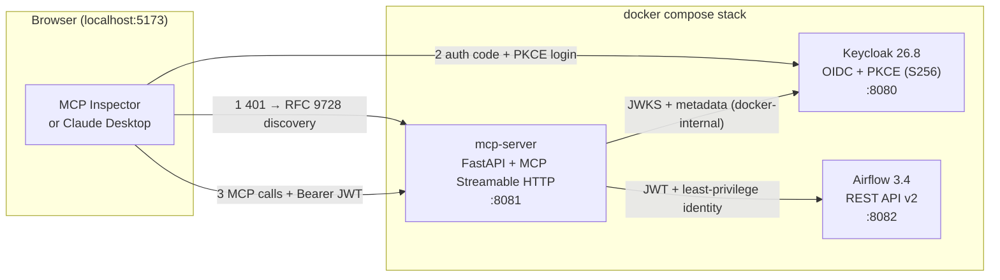
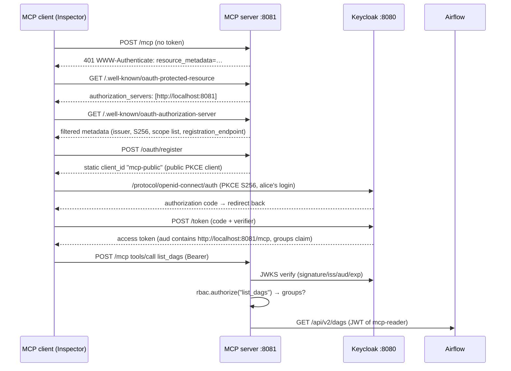

# airflow3-oidc-mcp-demo

A clean-room, self-contained reference for running an **MCP server in front of Apache Airflow 3**
with **interactive enterprise OAuth 2.1 / OIDC (PKCE)** — Keycloak standing in for Okta —
and **group-based guardrails** on every tool call.

**Why this exists**

- Airflow 3 has no official MCP server yet (AIP-91 is still under debate).
- Community wrappers (e.g. `astro-airflow-mcp`) authenticate with static bearer tokens,
  Basic Auth, or username/password exchanges — none of which survive an enterprise security
  review, and none of which do the interactive auth-code + PKCE flow MCP clients expect.
- MCP's own OAuth story (RFC 9728 resource metadata, dynamic registration, scope discovery)
  only partly matches what real IdPs emit. This repo is the missing bridge.

Everything is built from scratch with open-source tools — no proprietary code, no vendor SDKs.

## Architecture



**Trust boundaries**

| Hop | Credential | Checked by |
|---|---|---|
| Inspector → MCP server | Keycloak access token (RS256 JWT) | `oauth.py`: JWKS signature, `iss`, `aud`, `exp` |
| MCP tool call → tool | Keycloak `groups` claim | `rbac.py`: group ↔ tool map |
| MCP server → Airflow | Two Airflow JWTs (`mcp-reader`, `mcp-writer`) | Airflow simple auth manager roles (`viewer` / `op`) |

RBAC is enforced twice on purpose: the Keycloak group decides *which tools* you may call,
the Airflow role decides *what the underlying API identity could ever do* if that check were bypassed.

## Versions (pinned)

| Component | Version | Notes |
|---|---|---|
| Keycloak | `quay.io/keycloak/keycloak:26.8` | `start-dev --import-realm`, zero-click realm import |
| Apache Airflow | `apache/airflow:3.4.0` | REST API v2 (`/api/v2`), `POST /auth/token` JWTs, simple auth manager |
| MCP server runtime | `python:3.12-slim` | |
| `mcp` (official SDK) | `2.3.0` | v2 `MCPServer` + Streamable HTTP sub-app |
| `fastapi` / `uvicorn` | `0.163.1` / `0.54.0` | metadata endpoints + CORS host |
| `httpx` / `PyJWT` | `0.28.1` / `2.15.1` | async IdP/Airflow clients, JWKS JWT validation |

Storage is deliberately dumb for a demo: Keycloak runs on its dev-file H2 (persisted in a
volume), Airflow on SQLite with `LocalExecutor` via `airflow standalone`.
Neither is a production topology — see *Demo-only shortcuts* below.

## Quickstart (zero-click)

```bash
cp .env.example .env        # optional — every value has a default
docker compose up --build
docker compose ps           # wait until Keycloak + Airflow report healthy (~60 s)
```

On first boot Keycloak imports `keycloak/realm-export.json`: the realm, the pre-registered
public PKCE client `mcp-public`, both groups, both users, the audience + group protocol
mappers. No console clicking.

| Service | URL |
|---|---|
| Keycloak | <http://localhost:8080> (admin: `admin` / `admin-demo`) |
| Airflow UI / API | <http://localhost:8082/api/v2> (reader: `mcp-reader` / `reader-demo`) |
| MCP server | <http://localhost:8081/mcp> |

Demo users (baked into the realm export):

| User | Password | Keycloak group | May call |
|---|---|---|---|
| `alice` | `alice-demo` | `airflow-viewer` | `list_dags`, `get_dag_runs`, `get_task_logs` |
| `bob` | `bob-demo` | `airflow-operator` | all of the above + `trigger_dag_run` |

## Test it with `@modelcontextprotocol/inspector`

```bash
npx @modelcontextprotocol/inspector
```

1. In the Inspector UI choose transport **Streamable HTTP**, URL
   `http://localhost:8081/mcp`, and press **Connect**.
2. The server answers `401` with
   `WWW-Authenticate: Bearer resource_metadata="http://localhost:8081/.well-known/oauth-protected-resource"` —
   the Inspector starts OAuth discovery on its own:
   - fetches the RFC 9728 protected-resource document,
   - follows `authorization_servers` to `/.well-known/oauth-authorization-server`
     (the *filtered* document this server publishes),
   - registers via `POST /oauth/register` and receives the pre-registered public
     PKCE client `mcp-public`,
   - redirects you to Keycloak — log in as **`alice` / `alice-demo`**.
3. You land back in the Inspector with a bearer token attached. **List Tools** shows the
   four Airflow tools with their annotations.
4. Run `list_dags` → the `demo_report` DAG comes back.
5. Run `trigger_dag_run` with `dag_id: "demo_report"` → **denied**:
   `denied: tool 'trigger_dag_run' requires Keycloak group [airflow-operator]; token groups: [airflow-viewer]`.
6. Log out / clear the Inspector's stored token, reconnect as **`bob` / `bob-demo`**,
   and the same call succeeds — a run shows up in Airflow under `demo_report`.

## Manual verification with curl

Discovery and registration (no auth needed):

```bash
curl -s http://localhost:8081/.well-known/oauth-protected-resource | jq
curl -s http://localhost:8081/.well-known/oauth-authorization-server | jq
curl -s -X POST http://localhost:8081/oauth/register | jq .client_id   # -> "mcp-public"
```

The unauthenticated MCP endpoint steers clients into discovery:

```bash
curl -si -X POST http://localhost:8081/mcp \
  -H 'Content-Type: application/json' \
  -H 'Accept: application/json, text/event-stream' \
  -d '{"jsonrpc":"2.0","id":1,"method":"initialize","params":{"protocolVersion":"2025-06-18","capabilities":{},"clientInfo":{"name":"curl","version":"0"}}}' \
  | grep -i www-authenticate
# www-authenticate: Bearer resource_metadata="http://localhost:8081/.well-known/oauth-protected-resource"
```

Get a token (the direct-access grant is enabled **for curl demos only** — the real flow is
the auth-code + PKCE browser flow above) and inspect the claims the server enforces:

```bash
export TOKEN=$(curl -s -X POST \
  http://localhost:8080/realms/airflow-demo/protocol/openid-connect/token \
  -d client_id=mcp-public -d grant_type=password \
  -d username=alice -d password=alice-demo \
  -d 'scope=openid profile email' | jq -r .access_token)

python3 - <<'EOF'
import base64, json, os
tok = os.environ["TOKEN"]
print(json.dumps(json.loads(base64.urlsafe_b64decode(tok.split(".")[1] + "==")), indent=2))
EOF
# look for:  "iss": http://localhost:8080/realms/airflow-demo
#            "aud": "http://localhost:8081/mcp"
#            "groups": ["airflow-viewer"]
```

Airflow's own API (the hop the MCP server makes, using its two identities):

```bash
AF_TOKEN=$(curl -s -X POST http://localhost:8082/auth/token \
  -H 'Content-Type: application/json' \
  -d '{"username":"mcp-reader","password":"reader-demo"}' | jq -r .access_token)
curl -s http://localhost:8082/api/v2/dags -H "Authorization: Bearer $AF_TOKEN" | jq '.dags[].dag_id'
```

## What each file does

```text
docker-compose.yml              3 services: keycloak, airflow, mcp-server + healthchecks
.env.example                    all demo credentials, clearly labelled, defaults in compose
keycloak/realm-export.json      realm, public PKCE client, groups, users, aud/groups mappers
airflow/Dockerfile              apache/airflow:3.4.0 + demo DAG + credential entrypoint
airflow/entrypoint.sh           writes API passwords from env, runs `airflow standalone`
airflow/dags/demo_report_dag.py three-task DAG so tools have runs and logs to read
mcp_server/app/oauth.py         RFC 9728 metadata, RFC 8414 filtered/normalized proxy,
                                RFC 7591 static registration, JWKS JWT validation
mcp_server/app/rbac.py          Keycloak groups → tool permissions (the slide-sized file)
mcp_server/app/airflow_client.py async Airflow 3 REST API v2 client, two identities
mcp_server/app/main.py          MCP tools, Bearer auth middleware, discovery routes, CORS
slides/presentation_outline.md  5-slide Express talk package (Phase 2)
```

### The OAuth flow, concretely



## Security model & deliberate trade-offs

- **Validated:** RS256 signature against Keycloak's JWKS (cached, kid-rotation aware),
  `iss` == `http://localhost:8080/realms/airflow-demo`, `aud` contains
  `http://localhost:8081/mcp` (RFC 8707 resource indicator via Keycloak audience mapper),
  `exp` with 10 s leeway, required claims `exp/iat/iss/aud`.
- **Not scope-based:** the `scope` claim Keycloak emits only echoes the granted OIDC client
  scopes (`email profile`, or `openid profile email` when requested) — there are no per-tool
  authorization scopes — so authorization is carried by the `groups` claim — one mapper, one
  claim, one map. The metadata layer still filters `scopes_supported` so MCP clients request
  only what exists.
- **Two issuers on purpose:** the published metadata document's `issuer` must equal its own
  URL (RFC 8414), while the token's `iss` is Keycloak's. The resource server — not the
  client — is what checks the token issuer here.
- **Audience mapper pitfall:** `included.client.audience` silently wins over
  `included.custom.audience`; the client field must be empty for the URL audience to land.
- **DCR is a façade:** Keycloak's registration endpoint is replaced by a static one so
  clients always receive the pre-registered public PKCE client instead of minting
  unmanaged clients in the realm.

**Demo-only shortcuts — not for production:** direct-access grant enabled on `mcp-public`;
Airflow simple-auth-manager passwords written in plaintext from env; Keycloak dev-file H2;
SQLite metadata DB; CORS/redirect URIs pinned to `localhost`; default `alice`/`bob`
credentials inside `realm-export.json`.

## Troubleshooting

- **`421 Misdirected Request` on `/mcp`** — the MCP transport's DNS-rebinding allowlist
  doesn't match your Host header. Adjust `MCP_ALLOWED_HOSTS` (must match the URL you
  actually use).
- **CORS error on Keycloak's token endpoint** — the browser origin must be listed in
  `webOrigins` of the `mcp-public` client in `realm-export.json` (exact string match).
- **Realm changes don't apply** — `--import-realm` only imports on first boot:
  `docker compose down -v` wipes the `keycloak-data` volume.
- **Port conflicts** — override `KEYCLOAK_PORT`, `AIRFLOW_PORT`, `MCP_PORT` in `.env`.
  If you change `MCP_PORT`, also update `included.custom.audience` in
  `keycloak/realm-export.json` and the audience it must match.

## License

MIT — clean-room implementation; bring your own IdP.