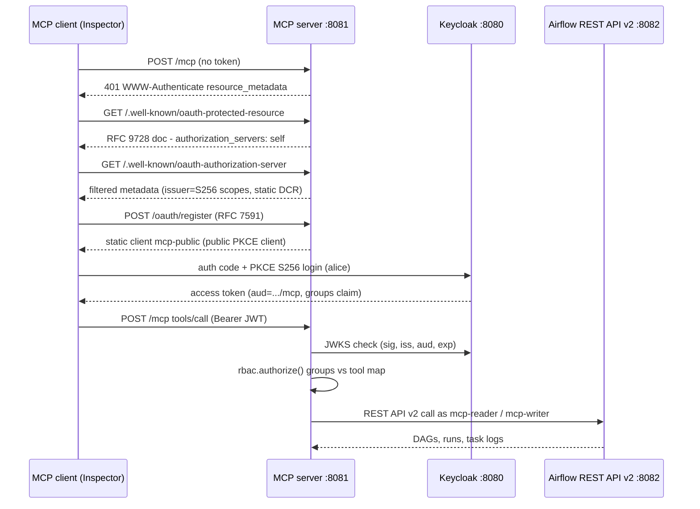
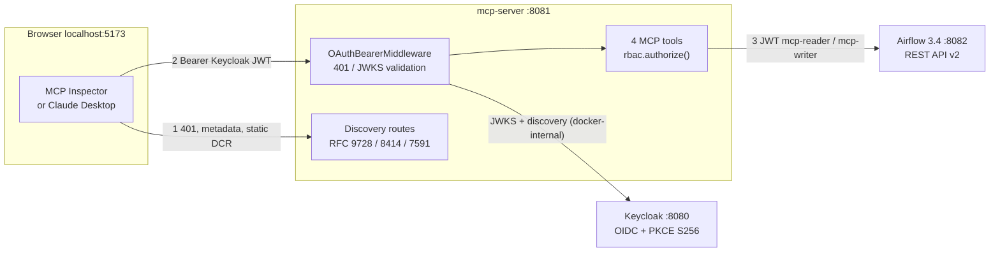

# Programmable 2027 — Express Talk Package (20 min, max 5 slides)

**Talk:** Programmable 2027, Express format — 20 minutes, 5 slides max
**Repo:** https://github.com/allentv/airflow3-oidc-mcp-demo
**Total time:** 3 + 4 + 6 + 4 + 3 = 20 min

---

## Slide 1 — The Goal & The Gap (3 min)

### On-slide visual/text

- **Ask:** "Which DAGs failed overnight?" — answered *inside* the ops client, via MCP
- **Want:** interactive login, least privilege, an audit trail per tool call
- **Airflow 3.4 ships no MCP server** — AIP-91 is still under debate
- **Community wrappers:** static bearer token / Basic Auth / password grant → **dead on arrival** in security review
- **MCP's OAuth story (RFC 9728 + DCR + scopes) only half-matches real IdPs**
- **This repo: the missing bridge** — Keycloak as Okta stand-in, group guardrails on every tool

> The gap isn't "an MCP server for Airflow" — it's an MCP server an enterprise will *sign off on*.

### Speaker notes

Start with the honest motivation: ops teams want to ask their AI client questions about Airflow — "list the DAGs", "pull the logs for the failed run", "kick off the backfill" — and today the only way to do that is a hand-rolled script with a long-lived token baked into it. Airflow 3 is new, AIP-91 (the official MCP server) is still being debated, and the community wrappers that exist authenticate with static bearer tokens, Basic Auth, or username/password exchanges. Every one of those fails the first five minutes of an enterprise security review: no interactive login, no PKCE, no per-user identity, a token that lives forever and can't be scoped.

Meanwhile MCP clients — Inspector, Claude Desktop, the growing menagerie — expect the OAuth 2.1 dance: hit a 401, discover metadata, register a client, do the auth-code flow with PKCE. That spec assumes an authorization server that behaves. Real IdPs — Okta, Keycloak — advertise forty scopes you don't enforce, a DCR endpoint you don't want clients using, and issuer rules that fight you. This talk is about building the thin normalization layer between those two worlds, and the three sharp edges we hit doing it.

---

## Slide 2 — Where MCP OAuth Meets Enterprise IdP Reality (4 min)

### On-slide visual/text



Friction the diagram papers over:

- **RFC 8414 §3.3:** metadata `issuer` must equal the document URL — but the token's `iss` stays Keycloak's → **two issuers on purpose**
- **Okta/Keycloak quirks:** 40-scope lists, live DCR endpoint, docker-internal vs browser-reachable URLs
- **Airflow 3 JWTs:** its own `/auth/token` identities — the user's Keycloak token never reaches Airflow

### Speaker notes

Walk the arrows left to right, then spend your time on the three friction points the diagram hides.

First: the 401. This is the whole ignition sequence — MCP clients see `WWW-Authenticate: Bearer resource_metadata=...` and start discovery on their own. If that header is missing or the metadata documents are off by one URL, the client just sits there. So we serve RFC 9728 ourselves, and RFC 8414 as a *filtered* proxy of Keycloak's document.

Second: the issuer trap. RFC 8414 says the `issuer` field in the metadata must equal the URL you fetched it from. Keycloak's real issuer is `http://localhost:8080/realms/airflow-demo`. Those can't both be true — so the published document rewrites `issuer` to our own URL, and the *resource server* (not the client) checks the token's actual `iss` against Keycloak. Same trick with registration: Keycloak has a live DCR endpoint; we hide it behind a static `POST /oauth/register` that always returns the pre-registered public PKCE client `mcp-public`. Clients think they did dynamic registration; the realm never grows rogue clients. It's a façade — and I'll defend that trade-off on Slide 4.

Third: there are *two* token architectures in this stack. The user's Keycloak JWT (RS256, `aud` = `http://localhost:8081/mcp`, carries `groups`) authenticates to us. Airflow has no idea who Keycloak is — it issues its own JWTs via `POST /auth/token` for two service identities, `mcp-reader` (viewer) and `mcp-writer` (op). We hold those credentials and pick the right one per tool. User identity at the edge, least-privilege service identity downstream.

---

## Slide 3 — Under the Hood — The Custom OAuth & MCP Bridge (6 min)

### On-slide visual/text



**Snippet A — RFC 9728 Protected Resource Metadata** (`mcp_server/app/oauth.py`):

```python
def protected_resource_metadata() -> dict[str, Any]:
    """Advertise this MCP server as a protected resource (RFC 9728 §2).

    A 401 from ``/mcp`` points clients here; ``authorization_servers`` points at
    this host, where the *filtered* AS metadata is served.
    """
    return {
        "resource": MCP_RESOURCE,
        "authorization_servers": [MCP_PUBLIC_URL],
        "scopes_supported": list(SUPPORTED_SCOPES),
        "bearer_methods_supported": ["header"],
    }
```

**Snippet B — Bearer JWT validation against Keycloak's JWKS** (`mcp_server/app/oauth.py`):

```python
    key = pyjwt.algorithms.RSAAlgorithm.from_jwk(jwk)
    try:
        return pyjwt.decode(
            token,
            key,
            algorithms=["RS256"],
            issuer=OIDC_ISSUER,
            audience=MCP_RESOURCE,  # RFC 8707 resource indicator
            leeway=10,
            options={"require": ["exp", "iat", "iss", "aud"]},
        )
```

### Speaker notes

This is the six-minute slide, so slow down on the two code blocks.

Snippet A is twelve lines and it is the entire "hello" of MCP OAuth. A 401 from `/mcp` points the client here; `authorization_servers` points at *this* host — because the filtered AS metadata lives here, not at Keycloak. Note what's *not* in it: no Keycloak URL. The client never talks to the IdP's discovery document directly; every document we publish is normalized first — scopes filtered to the three we actually enforce, `registration_endpoint` swapped to our static `/oauth/register`, endpoints pinned instead of IdP-generated.

Snippet B is where we stop being a proxy and become a resource server. The kid from the JWT header indexes a JWKS cache with a five-minute TTL; an unknown `kid` forces exactly one refresh, rate-limited to once per ten seconds, so a flood of garbage tokens can't hammer Keycloak — that's the kid-rotation path working, with a DoS guard around it. Then `pyjwt.decode` with `issuer=OIDC_ISSUER` (Keycloak's real issuer, not the rewritten one from the metadata — this is the two-issuer trick paying off), `audience=MCP_RESOURCE` which is RFC 8707: the token must be minted *for* `http://localhost:8081/mcp`, thanks to the audience mapper in the realm export. Ten seconds of leeway for clock skew, and `exp/iat/iss/aud` all *required* — a token missing any of them is rejected, not defaulted.

The middleware around it is deliberately dumb: no token → 401 with the discovery header; bad token → RFC 6750 error; good token → claims stashed in a `ContextVar` that `rbac.authorize()` reads inside each tool call. Auth terminates *outside* the MCP transport, so the transport only ever sees authenticated requests.

Trade-off worth saying out loud: the static DCR façade means we can't audit per-client registrations or rotate individual clients — there's exactly one client, `mcp-public`, public, PKCE-only. For a demo that's right; for production you'd back this with a real registration service and client rotation.

---

## Slide 4 — Guardrails & Sharp Edges (4 min)

### On-slide visual/text

**Snippet A — group claim → tool map** (`mcp_server/app/rbac.py`, 10 lines):

```python
VIEWER_GROUP = "airflow-viewer"      # read-only tools
OPERATOR_GROUP = "airflow-operator"  # read + write tools

# Which Keycloak groups may invoke each tool. Operators are a superset of viewers.
TOOL_ACCESS: dict[str, frozenset[str]] = {
    "list_dags": frozenset({VIEWER_GROUP, OPERATOR_GROUP}),
    "get_dag_runs": frozenset({VIEWER_GROUP, OPERATOR_GROUP}),
    "get_task_logs": frozenset({VIEWER_GROUP, OPERATOR_GROUP}),
    "trigger_dag_run": frozenset({OPERATOR_GROUP}),
}
```

**The denial your user actually sees** (`mcp_server/app/rbac.py`):

```python
        raise AuthorizationError(
            f"denied: tool {tool_name!r} requires Keycloak group [{need}]; token groups: [{have}]"
        )
```

**Three real gotchas from this build:**

1. **Redirect-URI / CORS mismatches** — `STATIC_REDIRECT_URIS` pins localhost:5173/3000; Keycloak's `webOrigins` must *exactly* match the browser origin or the token-endpoint CORS dies; wrong `Host` → `421 Misdirected Request` from the transport allowlist
2. **`scope` ≠ authorization** — Keycloak only echoes the OIDC scopes it granted (`openid profile email`); nothing maps a scope to a tool, so RBAC rides on the `groups` claim (one mapper, one claim, one map); we still *filter* `scopes_supported` so clients only ask for what exists
3. **Two token lifetimes** — Keycloak user JWT (`exp`, 10 s leeway) vs Airflow service JWTs minted via `/auth/token`; a restarted Airflow container invalidates cached service tokens → 401/403 until refreshed

### Speaker notes

Snippet A is the whole authorization model — one dict, four tools, two groups. `trigger_dag_run` is the only destructive tool, so it's the only one requiring `airflow-operator`. Bob is a superset of Alice; that's the entire role hierarchy. The denial message names both what you need and what you have, because the first time someone gets denied they will paste that error at you, and you want to answer it in one glance.

Now the three things that will bite you.

**Redirect URIs and CORS.** Our static registration hands clients `http://localhost:5173/*` and friends — fine for Inspector, but the moment your client's redirect lands on another port, Keycloak rejects the code exchange. And two layers must agree: Keycloak's `webOrigins` on the `mcp-public` client (exact string match, or the browser can't even POST to the token endpoint) and our own `MCP_ALLOWED_ORIGINS` / `MCP_ALLOWED_HOSTS` for the MCP transport. Miss the host allowlist and you get a `421 Misdirected Request` that looks like an auth bug and isn't.

**Scopes.** The MCP spec talks about scopes; Keycloak — like Okta by default — only echoes the OIDC scopes it granted into the token's `scope` claim (`openid profile email`), with no per-tool meaning. We tried to make scope-based RBAC work and the honest answer was: it doesn't, not without custom protocol mappers. So authorization rides on the `groups` claim from `oidc-group-membership-mapper`, and the metadata layer still filters `scopes_supported` down to three so clients don't request things nobody enforces. Scope list = advertising; groups = enforcement. Keep them straight.

**Expiry and refresh.** Two completely different token lifetimes. The user's Keycloak JWT gets checked on every request — `exp` with ten seconds of leeway, kid-aware JWKS refresh. But downstream, the Airflow service JWTs are minted per identity via `/auth/token`, and a container restart invalidates what you cached — we hit exactly that during e2e: six failing checks that were all a stale service JWT, fixed with a retry on 401/403. User tokens need a refresh flow; service tokens need re-authentication on failure. Different problems, don't reuse the fix.

---

## Slide 5 — Three Rules for Enterprise MCP Servers (3 min)

### On-slide visual/text

**Rule 1 — Publish your own metadata.**
Filter and normalize the IdP's documents; hide live DCR behind a static registration. The client should see *your* truth, not the IdP's raw output.

**Rule 2 — Authorize on claims you control.**
Validate `iss` + `aud` + `exp` on every request (RFC 8707 audience, not just "is it signed"), then map a claim you own — here, `groups` — to an explicit per-tool allowlist. Deny with a message that names both sides.

**Rule 3 — Separate identities per hop.**
User JWT at the edge, least-privilege service JWT downstream, and *test the failure path* — expiry, rotation, restart — not just the happy path.

**[QR CODE] → https://github.com/allentv/airflow3-oidc-mcp-demo**
*(placeholder: generate QR linking to the repo; zero-click `docker compose up --build`)*

### Speaker notes

Three things you can do Monday morning.

One: stop trusting your IdP's discovery documents. Whatever Okta or Keycloak hands you, publish a filtered version — scopes you enforce, endpoints you pinned, registration you control. It's fifty lines of proxy code and it eliminates an entire class of client-compat bugs.

Two: authorization on claims you own. Signature validation alone proves *someone* valid sent the token; it doesn't prove they can call your destructive tool. Check issuer, audience, expiry — audience especially, because a token minted for another resource will validate perfectly fine if you skip RFC 8707. Then one explicit map from claim to tool. No clever policy engine; a dict you can read in a code review.

Three: this stack has three token populations — the user's Keycloak JWT, the MCP session, and Airflow's service JWTs — and every production incident we had in this build was a lifecycle mismatch between two of them. So test expiry, test key rotation, test what happens when the downstream IdP restarts.

Scan the QR — full repo, realm export included, `docker compose up --build` and you're clicking through the flow in a minute. I'll take questions.

---

*All code snippets are verbatim from `mcp_server/app/oauth.py` (lines 75–86, 197–207) and `mcp_server/app/rbac.py` (lines 17–26, 60–62).*